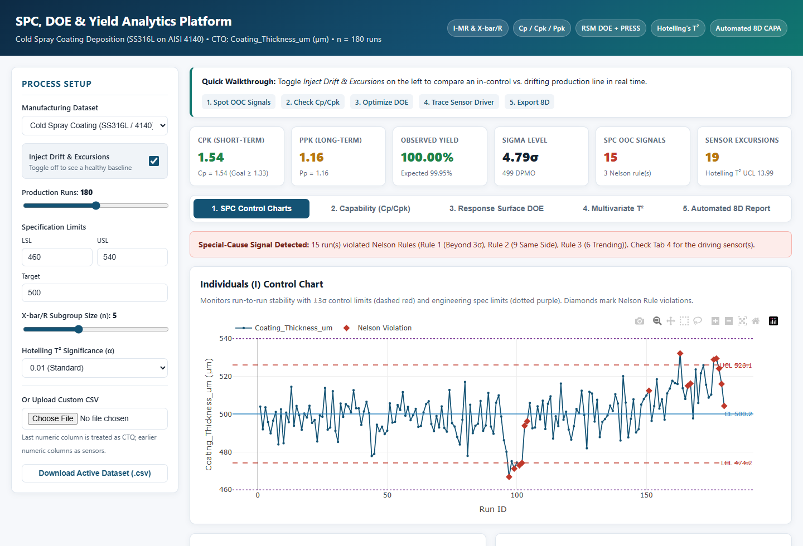
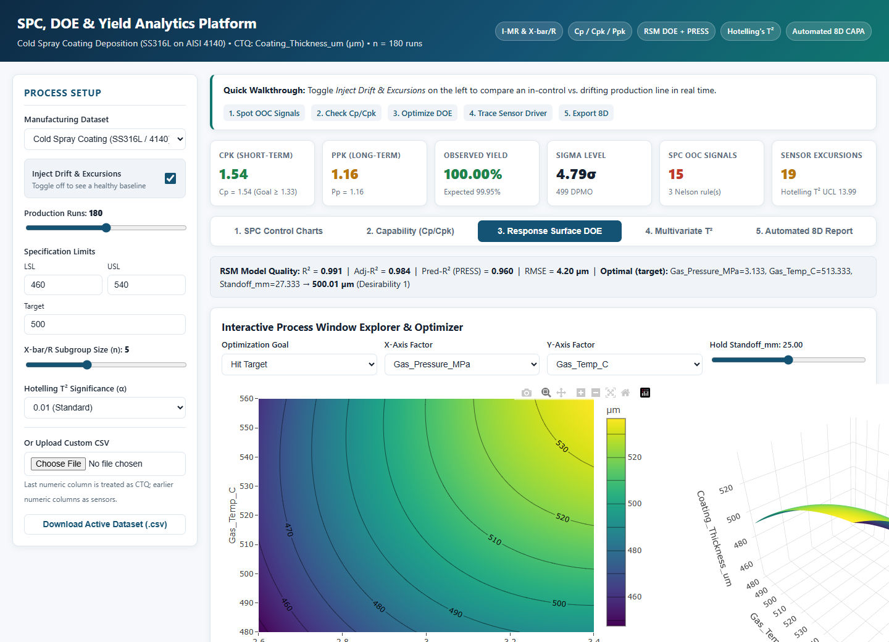
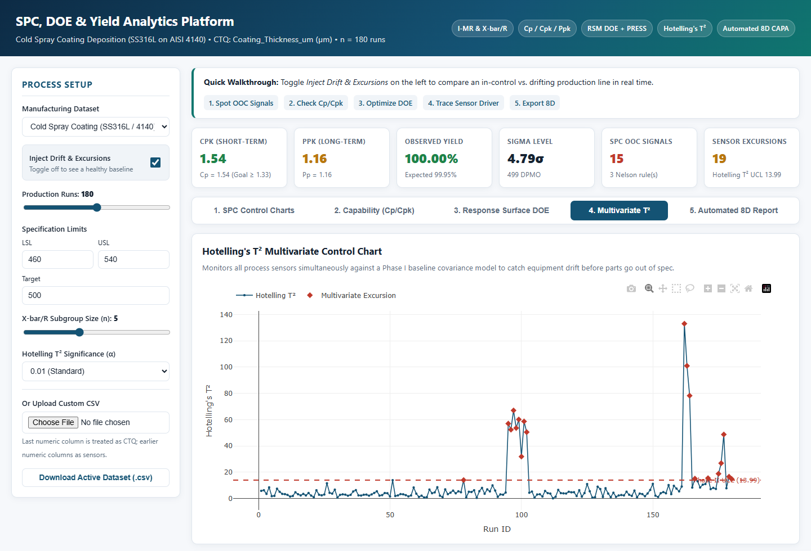

# SPC, DOE & Yield Analytics Platform

**Live Interactive Web App:** [https://abishekkafle.github.io/spc-doe-yield-analytics/](https://abishekkafle.github.io/spc-doe-yield-analytics/)

An interactive Python & Streamlit engineering analytics platform for **Statistical Process Control (SPC)**, **Process Capability (Cp/Cpk/Pp/Ppk)**, **Response Surface Methodology (RSM) DOE**, **Multivariate Sensor Anomaly Detection**, and **Automated 8D Root-Cause Reporting**.

---

## Dashboard Previews

### 1. SPC Control Charts & Executive Yield KPIs


### 2. Response Surface DOE (2D Process Window Contour, 3D Surface & Optimizer)


### 3. Multivariate Hotelling's T² Excursion Detection


Built to reflect real process, manufacturing, and quality engineering workflows across **Coatings / Cold Spray Deposition**, **Semiconductor Thin-Film Plasma Etch**, and **Laser Powder Bed Fusion (LPBF) Metal Additive Manufacturing**, with full support for uploading custom production CSV datasets.

---

## Key Engineering Capabilities

1. **Statistical Process Control (`src/spc.py`)**
   - **I-MR (Individuals & Moving Range)** and **X-bar / R** subgroup control charts using AIAG / Montgomery unbiasing constants ($d_2, A_2, D_3, D_4$).
   - **Nelson Rules 1–4** automatic detection (beyond $\pm 3\sigma$, 9 consecutive same-side mean shift, 6-point wear/drift trend, 14-point alternation).
2. **Process Capability & Yield (`src/spc.py`)**
   - Separates **short-term capability ($C_p, C_{pk}$)** using within-subgroup $\hat{\sigma}_{\text{within}} = \overline{MR}/d_2$ from **long-term performance ($P_p, P_{pk}$)** using overall sample $\hat{\sigma}_{\text{overall}}$.
   - Computes observed vs. expected yield, **DPMO**, **Sigma Level** (with $1.5\sigma$ shift convention), and runs a **Shapiro-Wilk normality check** to flag when normal-theory $C_{pk}$ assumptions are violated.
3. **Response Surface Methodology DOE (`src/doe.py`)**
   - Fits coded $[-1, +1]$ full 2nd-order quadratic models via OLS (`statsmodels`) on Central Composite Designs (CCD).
   - Computes term-level $t$-stats, $p$-values, $R^2$, Adjusted $R^2$, and exact **Predicted $R^2$ via PRESS** ($\sum (e_i / (1 - h_{ii}))^2$) to detect overfitting.
   - Generates interactive **2D contour** and **3D response surface** plots plus **Derringer-Suich desirability optimization** (`scipy.optimize` multi-start L-BFGS-B).
4. **Multivariate Anomaly Detection & Sensor Attribution (`src/anomaly.py`)**
   - Combines **Hotelling's $T^2$** (Phase I baseline with exact $F$-distribution Phase II UCL) and **Isolation Forest** to catch both linear drift and nonlinear multi-sensor excursions.
   - Attributes every flagged run to its top driving sensor(s) via baseline-normalized $Z$-scores.
5. **Automated 8D CAPA Report Generator (`src/report_8d.py`)**
   - Deterministically synthesizes SPC signals, capability gaps ($C_p - C_{pk}$ centering vs. $C_{pk} - P_{pk}$ drift), multivariate sensor drivers, and optimal DOE setpoints into a downloadable **D1–D8 Markdown report** (no external API keys required).

---

## Project Structure

```text
spc-doe-yield-analytics/
├── index.html                 # Zero-backend GitHub Pages web app (instant load)
├── web/
│   ├── styles.css             # Responsive modern engineering UI
│   ├── analytics.js           # Client-side SPC, RSM DOE (PRESS), Hotelling T², 8D engine
│   └── app.js                 # Interactive Plotly.js UI & CSV upload controller
├── app.py                     # Python Streamlit web app (with Isolation Forest + SciPy)
├── src/
│   ├── data_generator.py      # 3 physics-inspired manufacturing datasets + CCD generator
│   ├── spc.py                 # I-MR, X-bar/R, Nelson rules, Cp/Cpk/Pp/Ppk, DPMO
│   ├── doe.py                 # 2nd-order RSM, PRESS Pred-R², 2D/3D grids, L-BFGS-B optimizer
│   ├── anomaly.py             # Hotelling's T² + Isolation Forest + sensor Z-score attribution
│   └── report_8d.py           # Automated D1–D8 Markdown CAPA report generator
├── tests/
│   └── test_analytics.py      # Pytest verification suite (6/6 passing)
├── .streamlit/config.toml     # Clean engineering UI theme
└── requirements.txt
```

---

## Live Deployment (Free, Zero Sleep Time on GitHub Pages)

Because the repository includes a full client-side HTML/CSS/JS build at `index.html`, recruiters can open your live app **instantly** with zero server cold-start:

1. Push this folder to a public GitHub repository (e.g., `spc-doe-yield-analytics`).
2. In GitHub, go to **Settings → Pages → Build and deployment**.
3. Set **Source** to `Deploy from a branch`, select `main` and `/ (root)`, and click **Save**.
4. Your live interactive app will be available at `https://<your-username>.github.io/spc-doe-yield-analytics/`.

## Local Python & Streamlit Run

```bash
pip install -r requirements.txt
pytest -v
streamlit run app.py
```
